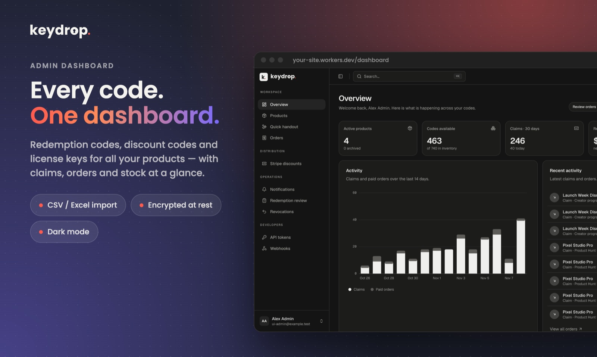
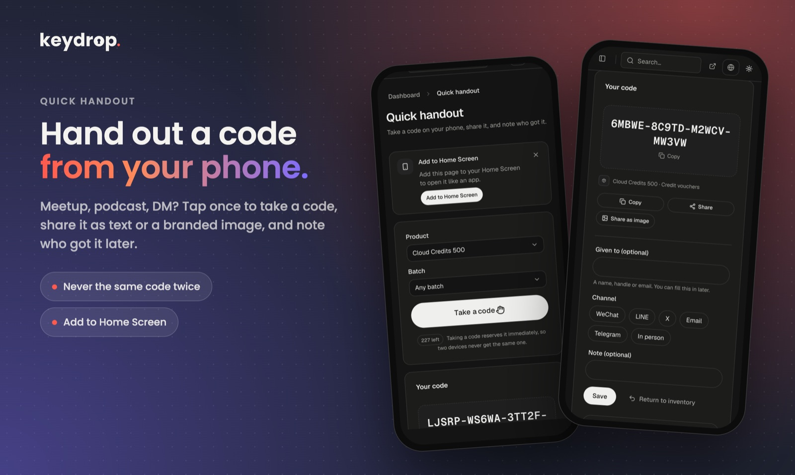
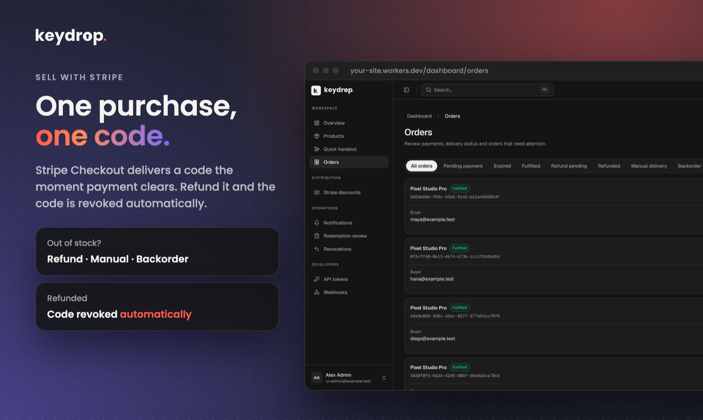
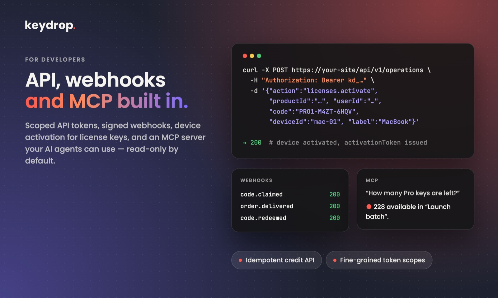
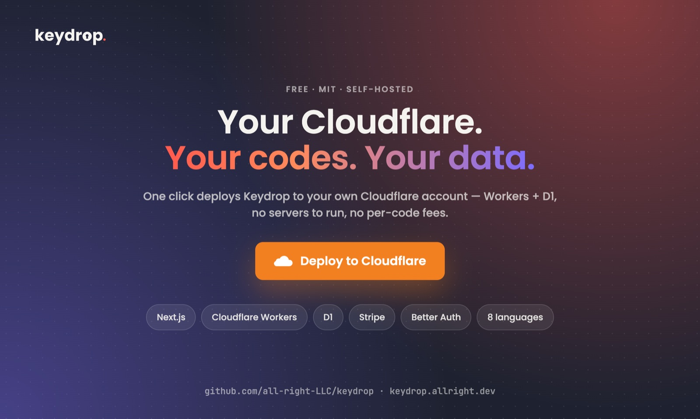

<p align="center">
  <picture>
    <source media="(prefers-color-scheme: dark)" srcset="apps/web/public/brand/keydrop-wordmark-dark.svg">
    
  </picture>
</p>

<p align="center"><a href="README.md">English</a> · <a href="README.zh-Hant.md">繁體中文</a> · <a href="README.zh-Hans.md">简体中文</a> · <a href="README.ja.md">日本語</a> · <a href="README.ko.md">한국어</a> · <a href="README.it.md">Italiano</a> · <b>Deutsch</b> · <a href="README.ar.md">العربية</a></p>

**Selbst gehostete Code-Verteilung für Indie-Entwickler.** Verwalte und verteile Einlösecodes, Rabattcodes, Lizenzschlüssel und App-Store-Promo-Codes aus deinem eigenen Cloudflare-Konto – kostenlose Claim-Kampagnen, Stripe Checkout, Berechtigungen, eine API, Webhooks und ein MCP-Server, alles in einer kleinen Next.js-App.

[](https://deploy.workers.cloudflare.com/?url=https%3A%2F%2Fgithub.com%2Fall-right-LLC%2Fkeydrop%2Ftree%2Fmain%2Fapps%2Fweb)

[](https://github.com/all-right-LLC/keydrop/actions/workflows/ci.yml)
[](LICENSE)

<a href="https://www.producthunt.com/products/keydrop-2?embed=true&utm_source=badge-featured&utm_medium=badge&utm_campaign=badge-keydrop-2" target="_blank" rel="noopener noreferrer"><picture><source media="(prefers-color-scheme: dark)" srcset="https://api.producthunt.com/widgets/embed-image/v1/featured.svg?post_id=1308544&theme=dark"></picture></a>

> **Status:** vor 1.0. Die Kernabläufe laufen auf Cloudflare durchgängig, aber rechne vor 1.0 mit Breaking Changes. Teste es in deiner eigenen Umgebung, bevor du dich bei echten Verkäufen darauf verlässt.

<p align="center"></p>

<table>
  <tr>
    <td width="50%"></td>
    <td width="50%"></td>
  </tr>
  <tr>
    <td width="50%"></td>
    <td width="50%"></td>
  </tr>
</table>

## Warum Keydrop

Du hast eine App gebaut und jetzt eine Tabelle voller Promo-Codes, ein paar hundert Lizenzschlüssel und ein Stripe-Konto. Keydrop gibt diesen Codes ein Zuhause:

- **Ein Bestand für jede Art von Code** – erzeuge Codes, importiere sie aus CSV/Excel (App-Store-Angebotscodes, Partner-Schlüssel, Stripe-Promotion-Codes) und speichere sie verschlüsselt.
- **Verteile sie, wie du es brauchst** – öffentliche oder private Claim-Seiten mit Teilnahmeregeln, bezahlter Checkout über Stripe, direkte Zuweisung, Verteilung per E-Mail oder eine handyfreundliche *Quick handout*-Seite, um jemandem im Chat einen Code zu geben.
- **Wisse, wer was hat** – jeder Claim, jede Bestellung, jede Ausgabe und jede Einlösung wird protokolliert; widerrufe Codes, fordere Berechtigungen zurück und bearbeite Rückerstattungen, ohne den Verlauf zu verlieren.
- **Binde es in dein Produkt ein** – API-Tokens mit eingeschränkten Rechten, eine REST-API, signierte Webhooks und ein MCP-Server, damit dein Backend oder deine KI-Agenten Codes ausgeben und prüfen können.
- **Du betreibst es selbst** – MIT-lizenziert, ein einzelner Administrator, wird in deine eigenen Cloudflare Workers + D1 deployt. Kein gehosteter Dienst, keine Gebühren pro Code.

## Funktionen

**Codes & Bestand**
- Vier Code-Arten: Einlösecodes, Rabattcodes, Lizenzen (Online-Aktivierung mit Gerätelimits) und Codes externer Plattformen
- Erzeugen, Importieren (.xlsx / CSV mit Spaltenzuordnung und Vorschau) und Synchronisieren von Stripe-Promotion-Codes
- AES-GCM-Verschlüsselung im Ruhezustand, Suche nach exakter Übereinstimmung, Export, Widerrufen / Wiederherstellen, Ablaufdatum und Nutzungslimits pro Code
- Eindeutige oder gemeinsam genutzte Codes, mit Limits für gemeinsame Claims über Kampagnen und Verkäufe hinweg

**Verteilung**
- Claim-Kampagnen: öffentliche oder private Links, anonym / mit verifizierter E-Mail / nur mit Konto, Limits pro Person und insgesamt, verschachtelte UND/ODER-Teilnahmeregeln (Zeitfenster, Passphrasen, Einladungen, Kaufhistorie, deine eigene HTTP-Prüfung)
- Stripe Checkout: ein Code pro Kauf, Rabatte, Rückerstattungen, die den Code widerrufen können, und drei Strategien bei fehlendem Bestand (Rückerstattung, manuelle Erfüllung, automatische Erfüllung nach Nachschub)
- Direkte Zuweisung und Verteilung per E-Mail an Personen, die noch kein Konto haben
- **Quick handout** – eine Mobile-First-Seite, um einen Code zu nehmen, ihn zu teilen (inklusive drei teilbarer Bildkarten, die auf dem Gerät gezeichnet werden) und zu notieren, wer ihn bekommen hat; lässt sich auf dem Startbildschirm installieren

**Belohnungen & Berechtigungen**
- Integrierte Mitgliedschaften (befristet oder dauerhaft) und Guthabenkonten mit idempotenten APIs zum Abbuchen / Erstatten
- Wiederholte Belohnungen addieren, ersetzen oder ablehnen; ungenutzte Berechtigungen zurückfordern, wenn ein Code widerrufen wird
- Externe Belohnungen, die an deinen eigenen Dienst geliefert werden, mit manueller Prüfung, wenn das Ergebnis unklar ist

**Integrationen**
- REST-API und ein MCP-Server mit fein granularen, produktbezogenen Tokens (MCP ist standardmäßig schreibgeschützt)
- Signierte ausgehende Webhooks mit Wiederholungsversuchen
- Optional Cloudflare Email Sending für die Anmeldung per Einmalcode, Code-E-Mails und Admin-Benachrichtigungen

**Admin-Konsole**
- Dashboard im SaaS-Stil mit Aktivitätsdiagrammen, ⌘K-Befehlspalette, hellem / dunklem Design und mobilem Layout, gebaut mit [beUI](https://beui.dev)-Komponenten
- Oberfläche auf English, 简体中文, 繁體中文, 日本語, 한국어, Italiano, Deutsch und العربية (Rechts-nach-links wird unterstützt); die Sprache folgt dem Browser des Besuchers und lässt sich jederzeit umschalten

## Tech-Stack

[Next.js](https://nextjs.org) (App Router) auf [Cloudflare Workers](https://workers.cloudflare.com) via [OpenNext](https://opennext.js.org/cloudflare) · [Cloudflare D1](https://developers.cloudflare.com/d1/) · [Better Auth](https://better-auth.com) · [Stripe](https://stripe.com) (optional) · [next-intl](https://next-intl.dev) · [beUI](https://beui.dev) + Tailwind CSS

## Schnellstart

### Auf Cloudflare deployen

1. Klicke oben auf **Deploy to Cloudflare**. Cloudflare kopiert den Ordner `apps/web` in ein neues Repository in deinem GitHub-Konto und legt einen Worker und eine D1-Datenbank an.
2. Fülle die abgefragten Einstellungen aus:

   | Name | Was du einträgst |
   |---|---|
   | `APP_URL` | Der HTTPS-Origin der Seite, z. B. `https://keydrop.your-subdomain.workers.dev` (ohne abschließenden Schrägstrich) |
   | `ADMIN_EMAIL` | Die E-Mail-Adresse des einzigen Administrators |
   | `BETTER_AUTH_SECRET` | Ein zufälliges Secret, z. B. `openssl rand -hex 32` |
   | `SETUP_SECRET` | Ein weiteres zufälliges Secret, das einmalig auf der Setup-Seite verwendet wird |
   | `CODE_ENCRYPTION_KEY` | 64 Hex-Zeichen, z. B. `openssl rand -hex 32` – **sichere diesen Wert; geht er verloren, sind vorhandene Codes nicht mehr lesbar** |

   Verwende für jedes Secret einen anderen Wert. Lass den Build-Befehl leer und setze den Deploy-Befehl auf `pnpm run deploy`.
3. Öffne `APP_URL/setup`, gib `SETUP_SECRET` ein und wähle das Administrator-Passwort. Melde dich dann an und lege dein erstes Produkt an.

Der kostenlose Kern (Codes, Kampagnen, Claims) braucht nichts weiter. Stripe und Email Sending kannst du später hinzufügen, wenn du sie brauchst.

### Lokal ausführen

Benötigt Node.js 24+ und pnpm.

```sh
cd apps/web
pnpm install --frozen-lockfile
node scripts/create-local-env.mjs "$HOME/.config/keydrop/local.env" you@example.com
pnpm run db:migrate
KEYDROP_DEV_ENV_FILE="$HOME/.config/keydrop/local.env" pnpm dev
```

Öffne <http://localhost:3000/setup> und verwende das `SETUP_SECRET` aus der erzeugten Datei (liegt außerhalb des Repositorys und wird nie im Terminal ausgegeben).

### Manuell deployen

```sh
cd apps/web
pnpm exec wrangler login
pnpm exec wrangler d1 create keydrop   # Datenbank-ID in wrangler.jsonc eintragen
# Worker-Namen, APP_URL und ADMIN_EMAIL in wrangler.jsonc setzen, dann:
pnpm exec wrangler secret put BETTER_AUTH_SECRET
pnpm exec wrangler secret put SETUP_SECRET
pnpm exec wrangler secret put CODE_ENCRYPTION_KEY
pnpm run deploy                        # baut, wendet D1-Migrationen an, deployt
```

## Konfiguration

| Einstellung | Typ | Erforderlich | Zweck |
|---|---|---|---|
| `APP_URL`, `ADMIN_EMAIL` | var | ja | Öffentlicher Origin und Administrator-E-Mail |
| `BETTER_AUTH_SECRET`, `SETUP_SECRET`, `CODE_ENCRYPTION_KEY` | secret | ja | Sessions und Identitäts-Hashing, einmaliges Setup, Code-Verschlüsselung |
| `STRIPE_SECRET_KEY`, `STRIPE_WEBHOOK_SECRET` | secret | für Verkäufe | Stripe Checkout und der Webhook unter `/api/stripe/webhook` |
| `EMAIL` binding + `EMAIL_FROM` | binding / var | für E-Mail | Cloudflare Email Sending: OTP-Anmeldung, Code-E-Mails, Admin-Benachrichtigungen |
| `WEBHOOK_SECRETS` | secret | für Webhooks | Signatur-Secrets für ausgehende Webhooks |
| `ELIGIBILITY_SECRETS`, `EXTERNAL_REWARD_SECRETS` | secret | optional | Signatur-Secrets für deine eigenen Teilnahmeprüfungen und Empfänger externer Belohnungen |
| `KEYDROP_TELEMETRY` | var | standardmäßig an | Einmaliger anonymer Ping (zufällige ID + Version) nach der Einrichtung, nur zum Zählen der Installationen; mit `off` deaktivieren. [Details](docs/api/en/deployment.md#usage-statistics) |

Ein Cron-Trigger läuft alle fünf Minuten, um Reservierungen ablaufen zu lassen, Nachbestellungen zu erfüllen, wartende E-Mails zu senden und Webhooks zuzustellen. Führe nach dem Bearbeiten von `wrangler.jsonc` `pnpm run cf-typegen` aus.

Funktionsschalter (öffentliche Seiten, „My codes“, Admin-Benachrichtigungen per E-Mail) liegen in `apps/web/src/config/site.ts`; Branding und alle Texte liegen in `apps/web/messages/<locale>.json`.

## Mach es zu deinem

Alles, was ein typisches Deployment anpasst, liegt in einer Handvoll Dateien. Wenn du deine Änderungen dort hältst, kannst du Upstream-Updates später leichter übernehmen.

| Was du ändern willst | Wo (in `apps/web/`) |
|---|---|
| Markenname, Texte der Startseite und anderer Seiten, E-Mail-Texte | `messages/<locale>.json`: `common.brand`, `home`, `publicSite`, `email` (ändere denselben Schlüssel in jeder Sprache, die du auslieferst) |
| Abschnitte der Startseite und ihre Reihenfolge, optionale öffentliche Seiten, Schalter für „My codes“ und Admin-Benachrichtigungen | `src/config/site.ts` |
| „Powered by Keydrop“-Link im Footer und GitHub-Links (unter MIT optional, du kannst sie abschalten) | `src/config/site.ts`: `poweredBy.enabled`, `publicSite.repositoryUrl` |
| Layout und Grafiken der Startseite | `src/components/site/landing/sections.tsx`, `src/components/site/landing/hero-visual.tsx`, `src/app/page.tsx` |
| Funktionsseite und optionale Seiten (Doku, Preise, Demo, Changelog) | `src/app/features/page.tsx`, `src/app/[section]/page.tsx` |
| Logo, Favicon und App-Icons | `src/components/site/brand-logo.tsx`, `public/brand/`, `public/favicon.svg`, `src/app/favicon.ico`, `public/icons/`, `public/handout.webmanifest` |
| Farben und helles / dunkles Theme | `src/app/globals.css` (die `:root`-Tokens und `--brand-accent`) |
| Vorschaubild für soziale Netzwerke | Wird bei jedem Build von `scripts/generate-share-image.mjs` aus der Wortmarke und den `home`-Texten erzeugt |
| Sprachen der Oberfläche | `src/i18n/locales.ts` plus eine Datei pro Sprache in `messages/` |
| Worker-Name, öffentliche URL, Cron-Zeitplan, Bindings | `wrangler.jsonc` (danach `pnpm run cf-typegen` ausführen) |

Produkte, Preise, Kampagnen, Teilnahmeregeln, E-Mail-Versand und API-Tokens verwaltest du im Dashboard, nicht im Code.

Ändere Folgendes nur, wenn du weißt, warum: `migrations/` (neue Dateien hinzufügen, bestehende nie bearbeiten), `src/lib/server/` (Authentifizierung, Verschlüsselung, Zahlungs- und Bestandsregeln) und `src/components/motion/` (beUI-Komponenten; aktualisiere sie stattdessen aus dem Upstream).

## Dokumentation

Die vollständigen Anleitungen liegen in [`docs/api`](docs/api/README.md) auf **Englisch**, [繁體中文](docs/api/zh-Hant/README.md) und [简体中文](docs/api/zh-Hans/README.md). Eine deutsche Fassung gibt es nicht; die folgenden Links führen zur englischen Version:

- [Deployment, Backup & Wiederherstellung](docs/api/en/deployment.md) · [Lokale Entwicklung](docs/api/en/development.md) · [Anpassung & Admin-Konsole](docs/api/en/customization.md)
- [Authentifizierung & API-Tokens](docs/api/en/authentication.md) · [MCP](docs/api/en/mcp.md) · [Webhooks](docs/api/en/webhooks.md)
- [Kampagnenbedingungen](docs/api/en/conditions.md) · [Teilnahme-Hooks](docs/api/en/eligibility.md) · [Berechtigungen & Guthaben](docs/api/en/entitlements.md) · [Lizenzen](docs/api/en/licenses.md)
- [Stripe](docs/api/en/stripe.md) · [Stripe-Rabatte](docs/api/en/stripe-discounts.md) · [E-Mail](docs/api/en/email.md) · [Quick handout](docs/api/en/handouts.md)

## Übersetzungen

Die Oberfläche gibt es in acht Sprachen. Öffentliche Seiten haben außerdem Sprach-URLs wie `/ja/features` mit passenden `hreflang`-Tags und Sitemap-Einträgen, und E-Mails werden in der Sprache des jeweiligen Empfängers verschickt. Jede Sprache ist eine JSON-Datei in [`apps/web/messages`](apps/web/messages) mit genau denselben Schlüsseln wie `en.json`; ein Test prüft, dass jede Übersetzung dieselben Schlüssel und dieselben ICU-Platzhalter hat. Um eine Sprache hinzuzufügen, trag ihren Code in [`src/i18n/locales.ts`](apps/web/src/i18n/locales.ts) ein und lege die passende JSON-Datei an. Korrekturen von Muttersprachlern sind sehr willkommen.

## Entwicklung

```sh
cd apps/web
pnpm run lint
pnpm run typecheck
pnpm test                # Unit- und Integrationstests gegen echtes SQLite + Migrationen
pnpm run build:worker    # Produktions-Build des Workers
```

Die CI führt dieselben Prüfungen auf Node.js 24 und 26 aus, dazu ein frisches lokales D1-Setup, das Codes durchgängig claimt. Lies [CONTRIBUTING.md](CONTRIBUTING.md), bevor du einen Pull Request öffnest, und [SECURITY.md](SECURITY.md), um eine Sicherheitslücke zu melden.

## Lizenz

[MIT](LICENSE) © all right LLC. Die mitgelieferten [beUI](https://beui.dev)-Komponenten behalten ihre ursprüngliche MIT-Lizenz ([`apps/web/vendor/beui.LICENSE`](apps/web/vendor/beui.LICENSE)).

## Danksagung

Keydrop steht auf den Schultern dieser Projekte. Danke an alle, die sie bauen und pflegen:

- [Next.js](https://nextjs.org) und [React](https://react.dev): das App-Framework
- [OpenNext for Cloudflare](https://opennext.js.org/cloudflare), [Cloudflare Workers, D1](https://developers.cloudflare.com/) und [Wrangler](https://developers.cloudflare.com/workers/wrangler/): Hosting, Datenbank und Deployment
- [Better Auth](https://better-auth.com): Anmeldung, Sitzungen und E-Mail-Einmalcodes
- [Stripe](https://github.com/stripe/stripe-node): Zahlungen
- [next-intl](https://next-intl.dev) und [FormatJS](https://formatjs.github.io): Übersetzungen und Nachrichtenprüfung
- [beUI](https://beui.dev), [Tailwind CSS](https://tailwindcss.com), [Motion](https://motion.dev), [Lucide](https://lucide.dev), [Floating UI](https://floating-ui.com), [TanStack Virtual](https://tanstack.com/virtual), [next-themes](https://github.com/pacocoursey/next-themes), [clsx](https://github.com/lukeed/clsx) und [tailwind-merge](https://github.com/dcastil/tailwind-merge): die Oberfläche
- [Zod](https://zod.dev): Eingabevalidierung
- [Kysely](https://kysely.dev) und [kysely-d1](https://github.com/aidenwallis/kysely-d1): Datenbankzugriff für Better Auth
- [Model Context Protocol TypeScript SDK](https://github.com/modelcontextprotocol/typescript-sdk): der MCP-Server
- [SheetJS](https://sheetjs.com): Excel-Import
- [Geist](https://vercel.com/font) und [Poppins](https://fonts.google.com/specimen/Poppins): Schriften für Oberfläche und Logo
- [Vitest](https://vitest.dev), [TypeScript](https://www.typescriptlang.org) und [ESLint](https://eslint.org): Tests und Tooling
