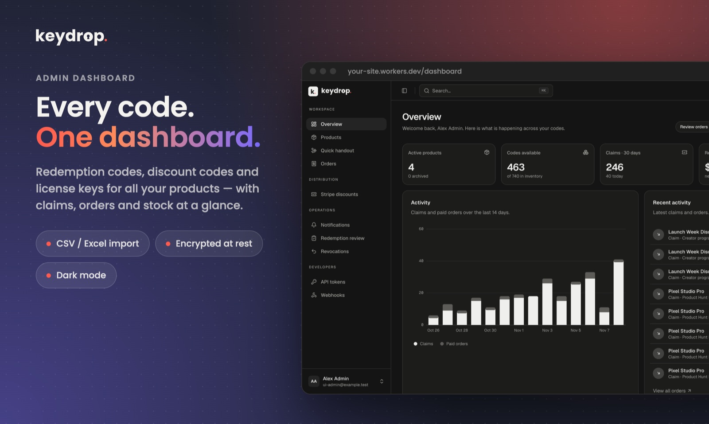
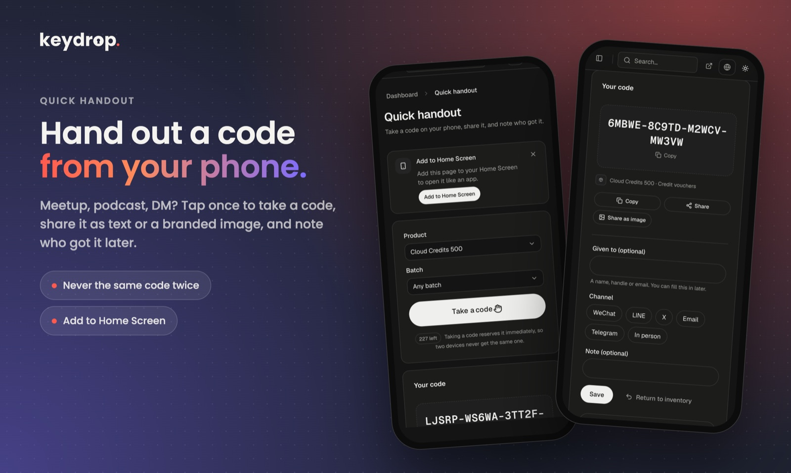
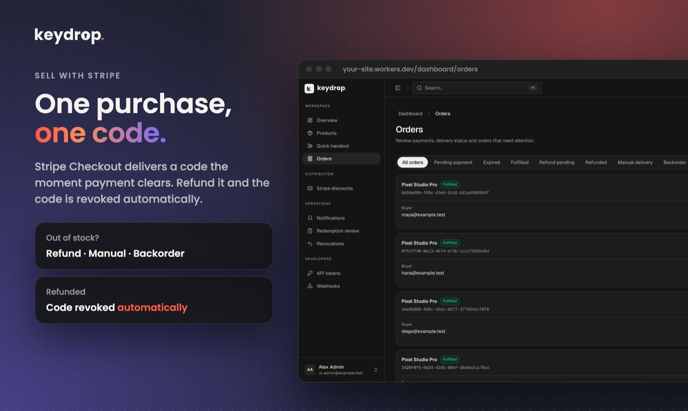
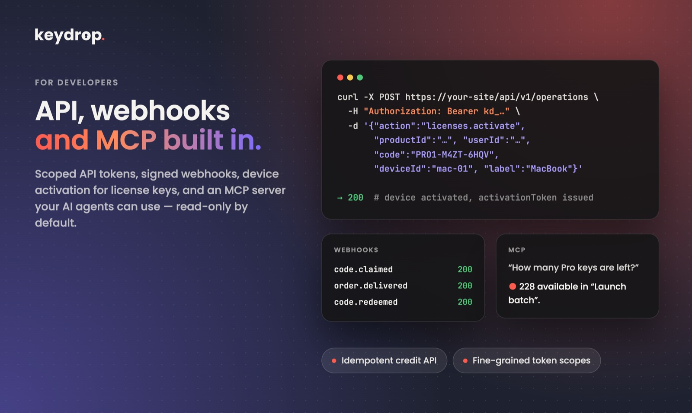
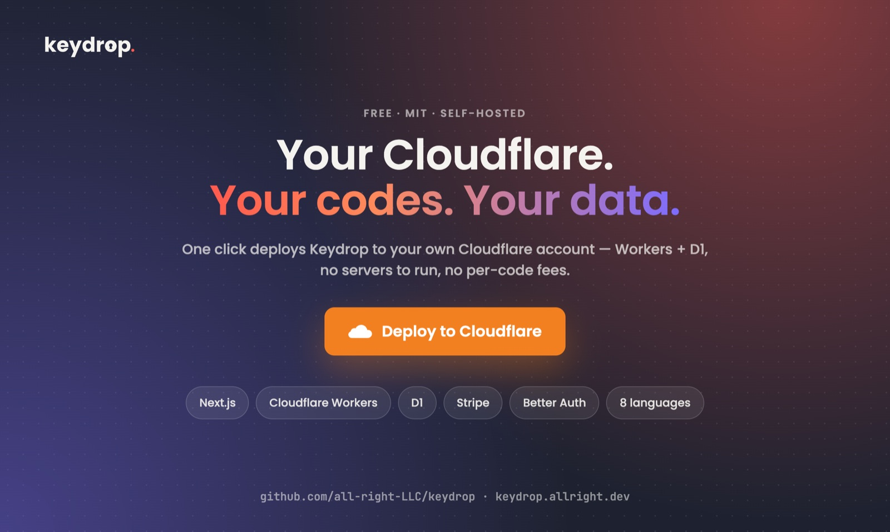

<p align="center">
  <picture>
    <source media="(prefers-color-scheme: dark)" srcset="apps/web/public/brand/keydrop-wordmark-dark.svg">
    
  </picture>
</p>

<p align="center"><a href="README.md">English</a> · <a href="README.zh-Hant.md">繁體中文</a> · <a href="README.zh-Hans.md">简体中文</a> · <a href="README.ja.md">日本語</a> · <a href="README.ko.md">한국어</a> · <b>Italiano</b> · <a href="README.de.md">Deutsch</a> · <a href="README.ar.md">العربية</a></p>

**Distribuzione di codici self-hosted per sviluppatori indipendenti.** Gestisci e distribuisci codici di riscatto, codici sconto, chiavi di licenza e codici promozionali App Store dal tuo account Cloudflare: campagne di riscatto gratuite, checkout Stripe, entitlement, un'API, webhook e un server MCP, tutto in una piccola app Next.js.

[](https://deploy.workers.cloudflare.com/?url=https%3A%2F%2Fgithub.com%2Fall-right-LLC%2Fkeydrop%2Ftree%2Fmain%2Fapps%2Fweb)

[](https://github.com/all-right-LLC/keydrop/actions/workflows/ci.yml)
[](LICENSE)

<a href="https://www.producthunt.com/products/keydrop-2?embed=true&utm_source=badge-featured&utm_medium=badge&utm_campaign=badge-keydrop-2" target="_blank" rel="noopener noreferrer"><picture><source media="(prefers-color-scheme: dark)" srcset="https://api.producthunt.com/widgets/embed-image/v1/featured.svg?post_id=1308544&theme=dark"></picture></a>

> **Stato:** pre-1.0. I flussi principali funzionano end-to-end su Cloudflare, ma prima della 1.0 sono possibili breaking change. Provalo nel tuo ambiente prima di usarlo per vendite reali.

<p align="center"></p>

<table>
  <tr>
    <td width="50%"></td>
    <td width="50%"></td>
  </tr>
  <tr>
    <td width="50%"></td>
    <td width="50%"></td>
  </tr>
</table>

## Perché Keydrop

Hai creato un'app e ora ti ritrovi con un foglio di calcolo pieno di codici promozionali, qualche centinaio di chiavi di licenza e un account Stripe. Keydrop dà una casa a quei codici:

- **Un unico inventario per ogni tipo di codice**: genera codici, importali da CSV/Excel (offer code App Store, chiavi dei partner, promotion code Stripe) e conservali cifrati a riposo.
- **Distribuiscili come preferisci**: pagine di riscatto pubbliche o private con regole di idoneità, checkout a pagamento con Stripe, assegnazione diretta, invio via email o una pagina *Quick handout* pensata per il telefono, per dare un codice a qualcuno in chat.
- **Sai chi ha cosa**: ogni riscatto, ordine, consegna e utilizzo viene registrato; revoca codici, recupera entitlement e gestisci i rimborsi senza perdere lo storico.
- **Integralo nel tuo prodotto**: token API con permessi limitati, un'API REST, webhook firmati e un server MCP, così il tuo backend o i tuoi agenti AI possono emettere e verificare codici.
- **Lo gestisci tu**: licenza MIT, un solo amministratore, deploy sui tuoi Cloudflare Workers + D1. Nessun servizio ospitato, nessun costo per codice.

## Funzionalità

**Codici e inventario**
- Quattro tipi di codice: riscatto, sconto, licenza (attivazione online con limiti per dispositivo) e codici di piattaforme esterne
- Generazione, importazione (.xlsx / CSV con mappatura delle colonne e anteprima) e sincronizzazione dei promotion code Stripe
- Cifratura AES-GCM a riposo, ricerca esatta, esportazione, revoca / ripristino, scadenza e limiti di utilizzo per codice
- Codici univoci o condivisi, con limiti di riscatto condivisi tra campagne e vendite

**Distribuzione**
- Campagne di riscatto: link pubblici o privati, accesso anonimo / con email verificata / solo con account, limiti per persona e totali, regole di idoneità AND/OR annidate (finestre temporali, passphrase, inviti, storico acquisti, un tuo controllo HTTP)
- Stripe Checkout: un codice per acquisto, sconti, rimborsi che possono revocare il codice e tre strategie in caso di esaurimento scorte (rimborso, evasione manuale, evasione automatica dopo il riassortimento)
- Assegnazione diretta e invio via email a persone che non hanno ancora un account
- **Quick handout**: una pagina mobile-first per prendere un codice, condividerlo (anche con tre card immagine condivisibili generate sul dispositivo) e annotare a chi è andato; installabile nella schermata Home

**Ricompense ed entitlement**
- Abbonamenti integrati (a tempo o permanenti) e registri di crediti con API di consumo / rimborso idempotenti
- Ricompense ripetute sommate, sostituite o rifiutate; recupero degli entitlement non usati quando un codice viene revocato
- Ricompense esterne consegnate al tuo servizio, con revisione manuale quando l'esito è sconosciuto

**Integrazioni**
- API REST e server MCP con token granulari limitati per prodotto (MCP è in sola lettura per impostazione predefinita)
- Webhook in uscita firmati, con nuovi tentativi
- Cloudflare Email Sending opzionale per accesso con codice monouso, email con i codici e avvisi all'amministratore

**Console di amministrazione**
- Dashboard in stile SaaS con grafici di attività, command palette ⌘K, temi chiaro / scuro e layout mobile, realizzata con componenti [beUI](https://beui.dev)
- Interfaccia in English, 简体中文, 繁體中文, 日本語, 한국어, Italiano, Deutsch e العربية (con supporto da destra a sinistra); la lingua segue il browser del visitatore e si può cambiare in qualsiasi momento

## Stack tecnologico

[Next.js](https://nextjs.org) (App Router) su [Cloudflare Workers](https://workers.cloudflare.com) tramite [OpenNext](https://opennext.js.org/cloudflare) · [Cloudflare D1](https://developers.cloudflare.com/d1/) · [Better Auth](https://better-auth.com) · [Stripe](https://stripe.com) (opzionale) · [next-intl](https://next-intl.dev) · [beUI](https://beui.dev) + Tailwind CSS

## Avvio rapido

### Deploy su Cloudflare

1. Fai clic su **Deploy to Cloudflare** qui sopra. Cloudflare copia la cartella `apps/web` in un nuovo repository del tuo account GitHub e crea un Worker e un database D1.
2. Compila le impostazioni richieste:

   | Nome | Cosa inserire |
   |---|---|
   | `APP_URL` | L'origine HTTPS del sito, ad es. `https://keydrop.your-subdomain.workers.dev` (senza barra finale) |
   | `ADMIN_EMAIL` | L'indirizzo email dell'unico amministratore |
   | `BETTER_AUTH_SECRET` | Un segreto casuale, ad es. `openssl rand -hex 32` |
   | `SETUP_SECRET` | Un altro segreto casuale, usato una sola volta nella pagina di configurazione |
   | `CODE_ENCRYPTION_KEY` | 64 caratteri esadecimali, ad es. `openssl rand -hex 32`. **Fanne un backup: se lo perdi, i codici esistenti diventano illeggibili** |

   Usa un valore diverso per ogni segreto. Lascia vuoto il comando di build e imposta il comando di deploy su `pnpm run deploy`.
3. Apri `APP_URL/setup`, inserisci `SETUP_SECRET` e scegli la password dell'amministratore. Poi accedi e crea il tuo primo prodotto.

Il core gratuito (codici, campagne, riscatti) non richiede altro. Aggiungi Stripe ed Email Sending in seguito, se ti servono.

### Esecuzione in locale

Richiede Node.js 24+ e pnpm.

```sh
cd apps/web
pnpm install --frozen-lockfile
node scripts/create-local-env.mjs "$HOME/.config/keydrop/local.env" you@example.com
pnpm run db:migrate
KEYDROP_DEV_ENV_FILE="$HOME/.config/keydrop/local.env" pnpm dev
```

Apri <http://localhost:3000/setup> e usa il `SETUP_SECRET` presente nel file generato (conservato fuori dal repository e mai stampato nel terminale).

### Deploy manuale

```sh
cd apps/web
pnpm exec wrangler login
pnpm exec wrangler d1 create keydrop   # inserisci l'ID del database in wrangler.jsonc
# imposta il nome del Worker, APP_URL e ADMIN_EMAIL in wrangler.jsonc, poi:
pnpm exec wrangler secret put BETTER_AUTH_SECRET
pnpm exec wrangler secret put SETUP_SECRET
pnpm exec wrangler secret put CODE_ENCRYPTION_KEY
pnpm run deploy                        # build, applica le migrazioni D1, deploy
```

## Configurazione

| Impostazione | Tipo | Obbligatoria | Scopo |
|---|---|---|---|
| `APP_URL`, `ADMIN_EMAIL` | var | sì | Origine pubblica ed email dell'amministratore |
| `BETTER_AUTH_SECRET`, `SETUP_SECRET`, `CODE_ENCRYPTION_KEY` | secret | sì | Sessioni e hashing delle identità, configurazione iniziale una tantum, cifratura dei codici |
| `STRIPE_SECRET_KEY`, `STRIPE_WEBHOOK_SECRET` | secret | per le vendite | Stripe Checkout e il webhook su `/api/stripe/webhook` |
| Binding `EMAIL` + `EMAIL_FROM` | binding / var | per le email | Cloudflare Email Sending: accesso OTP, email con i codici, avvisi all'amministratore |
| `WEBHOOK_SECRETS` | secret | per i webhook | Segreti di firma per i webhook in uscita |
| `ELIGIBILITY_SECRETS`, `EXTERNAL_REWARD_SECRETS` | secret | opzionale | Segreti di firma per i tuoi controlli di idoneità e i ricevitori di ricompense esterne |

Un cron trigger viene eseguito ogni cinque minuti per far scadere le prenotazioni, evadere gli ordini arretrati, inviare le email in coda e consegnare i webhook. Esegui `pnpm run cf-typegen` dopo aver modificato `wrangler.jsonc`.

Gli interruttori delle funzionalità (pagine pubbliche, "My codes", email di avviso all'amministratore) si trovano in `apps/web/src/config/site.ts`; branding e tutti i testi si trovano in `apps/web/messages/<locale>.json`.

## Personalizzalo

Tutto ciò che un deploy tipico modifica si trova in pochi file. Concentrare lì le tue modifiche rende più semplice integrare in seguito gli aggiornamenti upstream.

| Cosa vuoi cambiare | Dove (dentro `apps/web/`) |
|---|---|
| Nome del brand, testi della homepage e delle pagine, testi delle email | `messages/<locale>.json`: `common.brand`, `home`, `publicSite`, `email` (modifica la stessa chiave in ogni lingua che distribuisci) |
| Sezioni della homepage e il loro ordine, pagine pubbliche opzionali, interruttori per "My codes" e per gli avvisi all'amministratore | `src/config/site.ts` |
| Link “Powered by Keydrop” nel footer e link a GitHub (facoltativi con la licenza MIT; puoi disattivarli) | `src/config/site.ts`: `poweredBy.enabled`, `publicSite.repositoryUrl` |
| Layout e grafica della homepage | `src/components/site/landing/sections.tsx`, `src/components/site/landing/hero-visual.tsx`, `src/app/page.tsx` |
| Pagina delle funzionalità e pagine opzionali (documentazione, prezzi, demo, changelog) | `src/app/features/page.tsx`, `src/app/[section]/page.tsx` |
| Logo, favicon e icone dell'app | `src/components/site/brand-logo.tsx`, `public/brand/`, `public/favicon.svg`, `src/app/favicon.ico`, `public/icons/`, `public/handout.webmanifest` |
| Colori e tema chiaro / scuro | `src/app/globals.css` (i token `:root` e `--brand-accent`) |
| Immagine di condivisione social | Generata a ogni build dal logotipo e dai testi di `home` tramite `scripts/generate-share-image.mjs` |
| Lingue dell'interfaccia | `src/i18n/locales.ts` più un file per lingua in `messages/` |
| Nome del Worker, URL pubblico, pianificazione cron, binding | `wrangler.jsonc` (esegui poi `pnpm run cf-typegen`) |

Prodotti, prezzi, campagne, regole di idoneità, invio delle email e token API si gestiscono dalla dashboard, non nel codice.

Modifica questi solo se sai perché: `migrations/` (aggiungi nuovi file, non modificare mai quelli esistenti), `src/lib/server/` (autenticazione, cifratura, pagamenti e regole di inventario) e `src/components/motion/` (componenti beUI; aggiornali invece dall'upstream).

## Documentazione

Le guide complete si trovano in [`docs/api`](docs/api/README.md) in **inglese**, [繁體中文](docs/api/zh-Hant/README.md) e [简体中文](docs/api/zh-Hans/README.md). Non sono disponibili in italiano; i link qui sotto rimandano alla versione inglese:

- [Deploy, backup e ripristino](docs/api/en/deployment.md) · [Sviluppo locale](docs/api/en/development.md) · [Personalizzazione e console di amministrazione](docs/api/en/customization.md)
- [Autenticazione e token API](docs/api/en/authentication.md) · [MCP](docs/api/en/mcp.md) · [Webhook](docs/api/en/webhooks.md)
- [Condizioni delle campagne](docs/api/en/conditions.md) · [Hook di idoneità](docs/api/en/eligibility.md) · [Entitlement e crediti](docs/api/en/entitlements.md) · [Licenze](docs/api/en/licenses.md)
- [Stripe](docs/api/en/stripe.md) · [Sconti Stripe](docs/api/en/stripe-discounts.md) · [Email](docs/api/en/email.md) · [Quick handout](docs/api/en/handouts.md)

## Traduzioni

L'interfaccia è disponibile in otto lingue. Le pagine pubbliche hanno anche URL per lingua, come `/ja/features`, con i relativi tag `hreflang` e voci nella sitemap, e le email vengono inviate nella lingua di ciascun destinatario. Ogni locale è un file JSON in [`apps/web/messages`](apps/web/messages) con esattamente le stesse chiavi di `en.json`; un test verifica che ogni traduzione abbia le stesse chiavi e gli stessi placeholder ICU. Per aggiungere una lingua, aggiungi il suo codice a [`src/i18n/locales.ts`](apps/web/src/i18n/locales.ts) e crea il file JSON corrispondente. Le correzioni da parte di madrelingua sono molto gradite.

## Sviluppo

```sh
cd apps/web
pnpm run lint
pnpm run typecheck
pnpm test                # test unitari e di integrazione su SQLite reale + migrazioni
pnpm run build:worker    # build del Worker di produzione
```

La CI esegue gli stessi controlli su Node.js 24 e 26, più una configurazione D1 locale da zero che riscatta codici end-to-end. Leggi [CONTRIBUTING.md](CONTRIBUTING.md) prima di aprire una pull request e [SECURITY.md](SECURITY.md) per segnalare una vulnerabilità.

## Licenza

[MIT](LICENSE) © all right LLC. I componenti [beUI](https://beui.dev) inclusi mantengono la loro licenza MIT originale ([`apps/web/vendor/beui.LICENSE`](apps/web/vendor/beui.LICENSE)).

## Ringraziamenti

Keydrop poggia sulle spalle di questi progetti. Grazie a tutte le persone che li sviluppano e li mantengono:

- [Next.js](https://nextjs.org) e [React](https://react.dev): il framework dell'app
- [OpenNext for Cloudflare](https://opennext.js.org/cloudflare), [Cloudflare Workers, D1](https://developers.cloudflare.com/) e [Wrangler](https://developers.cloudflare.com/workers/wrangler/): hosting, database e deploy
- [Better Auth](https://better-auth.com): accesso, sessioni e codici monouso via email
- [Stripe](https://github.com/stripe/stripe-node): pagamenti
- [next-intl](https://next-intl.dev) e [FormatJS](https://formatjs.github.io): traduzioni e controllo dei messaggi
- [beUI](https://beui.dev), [Tailwind CSS](https://tailwindcss.com), [Motion](https://motion.dev), [Lucide](https://lucide.dev), [Floating UI](https://floating-ui.com), [TanStack Virtual](https://tanstack.com/virtual), [next-themes](https://github.com/pacocoursey/next-themes), [clsx](https://github.com/lukeed/clsx) e [tailwind-merge](https://github.com/dcastil/tailwind-merge): l'interfaccia
- [Zod](https://zod.dev): validazione degli input
- [Kysely](https://kysely.dev) e [kysely-d1](https://github.com/aidenwallis/kysely-d1): accesso al database per Better Auth
- [Model Context Protocol TypeScript SDK](https://github.com/modelcontextprotocol/typescript-sdk): il server MCP
- [SheetJS](https://sheetjs.com): importazione da Excel
- [Geist](https://vercel.com/font) e [Poppins](https://fonts.google.com/specimen/Poppins): caratteri tipografici dell'interfaccia e del logo
- [Vitest](https://vitest.dev), [TypeScript](https://www.typescriptlang.org) e [ESLint](https://eslint.org): test e strumenti di sviluppo
