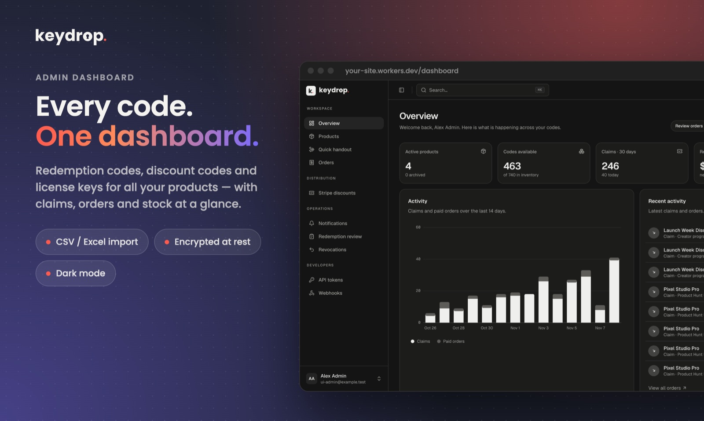
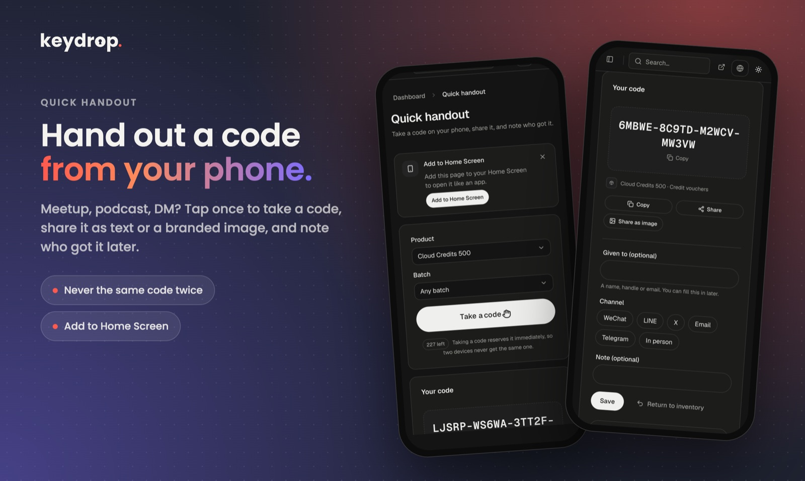
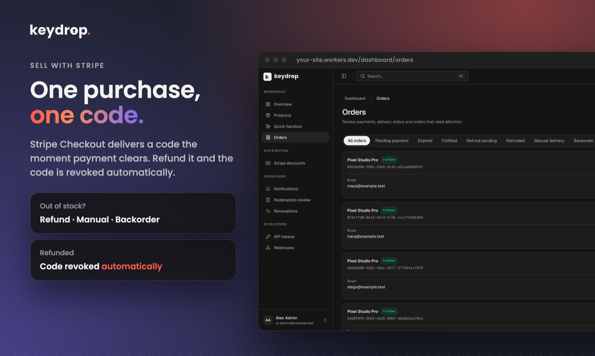
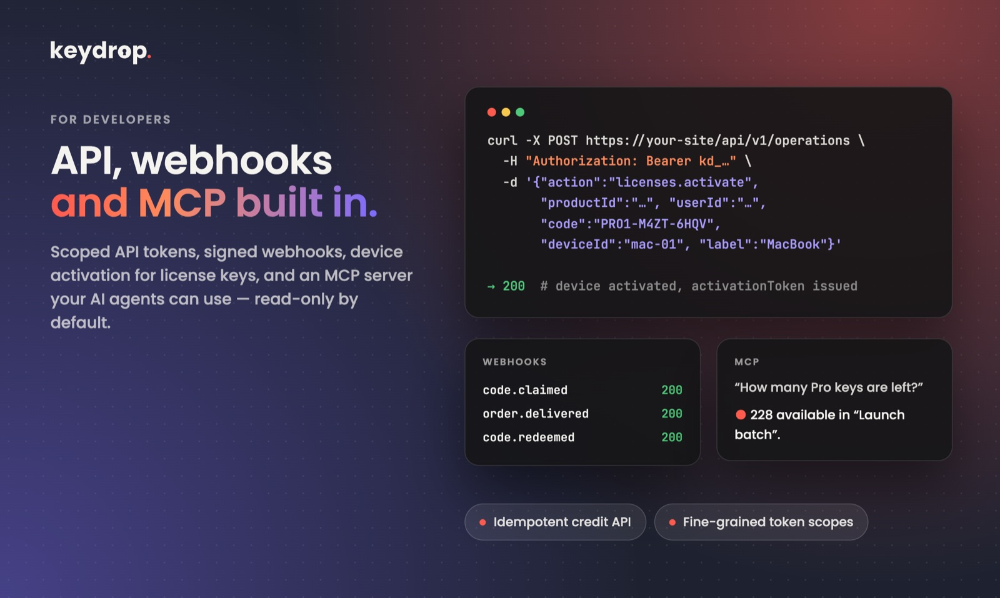
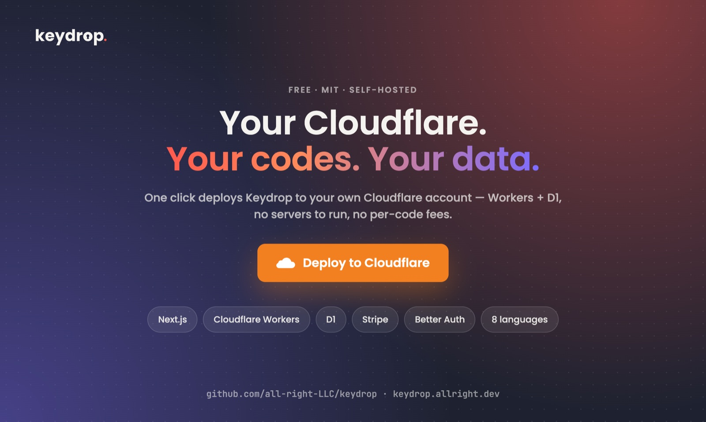

<p align="center">
  <picture>
    <source media="(prefers-color-scheme: dark)" srcset="apps/web/public/brand/keydrop-wordmark-dark.svg">
    
  </picture>
</p>

<p align="center"><a href="README.md">English</a> · <a href="README.zh-Hant.md">繁體中文</a> · <a href="README.zh-Hans.md">简体中文</a> · <b>日本語</b> · <a href="README.ko.md">한국어</a> · <a href="README.it.md">Italiano</a> · <a href="README.de.md">Deutsch</a> · <a href="README.ar.md">العربية</a></p>

**個人開発者のためのセルフホスト型コード配布ツールです。** 引き換えコード、割引コード、ライセンスキー、App Store プロモーションコードを、ご自身の Cloudflare アカウント上で管理・配布できます。無料の配布キャンペーン、Stripe 決済、利用権、API、Webhook、MCP サーバーを、ひとつの小さな Next.js アプリにまとめました。

[](https://deploy.workers.cloudflare.com/?url=https%3A%2F%2Fgithub.com%2Fall-right-LLC%2Fkeydrop%2Ftree%2Fmain%2Fapps%2Fweb)

[](https://github.com/all-right-LLC/keydrop/actions/workflows/ci.yml)
[](LICENSE)

<a href="https://www.producthunt.com/products/keydrop-2?embed=true&utm_source=badge-featured&utm_medium=badge&utm_campaign=badge-keydrop-2" target="_blank" rel="noopener noreferrer"><picture><source media="(prefers-color-scheme: dark)" srcset="https://api.producthunt.com/widgets/embed-image/v1/featured.svg?post_id=1308544&theme=dark"></picture></a>

> **ステータス：** 1.0 未満です。主要なフローは Cloudflare 上でエンドツーエンドに動作しますが、1.0 までは互換性のない変更が入る可能性があります。実際の販売に使う前に、ご自身の環境で十分にテストしてください。

<p align="center"></p>

<table>
  <tr>
    <td width="50%"></td>
    <td width="50%"></td>
  </tr>
  <tr>
    <td width="50%"></td>
    <td width="50%"></td>
  </tr>
</table>

## Keydrop を選ぶ理由

アプリを作ったら、手元にはプロモーションコードのスプレッドシート、数百件のライセンスキー、そして Stripe アカウントが残ります。Keydrop はそれらのコードの置き場所になります。

- **あらゆる種類のコードをひとつの在庫で管理** — コードを生成したり、CSV／Excel（App Store のオファーコード、パートナーのキー、Stripe のプロモーションコード）からインポートしたりでき、保存時は暗号化されます。
- **必要な方法で配布** — 参加条件付きの公開／非公開の受け取りページ、Stripe による有料決済、直接割り当て、メール配布、チャットで相手にコードを渡すためのスマートフォン向け *Quick handout* ページに対応しています。
- **誰が何を持っているかを把握** — 受け取り、注文、手渡し、引き換えはすべて記録されます。履歴を失わずに、コードの取り消し、利用権の回収、返金の処理ができます。
- **プロダクトに組み込める** — スコープ付き API トークン、REST API、署名付き Webhook、MCP サーバーにより、バックエンドや AI エージェントからコードの発行や確認ができます。
- **自分で運用できる** — MIT ライセンス、管理者は 1 人、ご自身の Cloudflare Workers + D1 にデプロイします。ホスティングサービスもコードごとの手数料もありません。

## 機能

**コードと在庫**
- 4 種類のコード：引き換えコード、割引コード、ライセンス（デバイス数制限付きのオンラインアクティベーション）、外部プラットフォームのコード
- 生成、インポート（列のマッピングとプレビュー付きの .xlsx / CSV）、Stripe プロモーションコードの同期
- AES-GCM による保存時の暗号化、完全一致検索、エクスポート、取り消し／復元、有効期限、コードごとの使用回数制限
- 一意のコードと共有コード。共有コードはキャンペーンや販売をまたいで受け取り上限を設定できます

**配布**
- 配布キャンペーン：公開／非公開リンク、匿名／メール認証済み／アカウント限定、1 人あたりと全体の上限、ネストした AND/OR の参加条件（期間、合言葉、招待、購入履歴、独自の HTTP チェック）
- Stripe Checkout：1 回の購入につき 1 コード、割引、コードを取り消せる返金、3 種類の在庫切れ対応（返金、手動での発送、補充後の自動発送）
- まだアカウントを持っていない相手への直接割り当てとメール配布
- **Quick handout** — コードを取り出して共有し（端末上で描画する 3 種類の共有用画像カードを含む）、誰に渡したかを記録できるモバイルファーストのページ。ホーム画面に追加できます

**特典と利用権**
- 組み込みのメンバーシップ（期間限定または永久）と、冪等な消費／返却 API を備えたクレジット台帳
- 重複した特典は累積・上書き・拒否から選択。コードを取り消した際は未使用の利用権を回収
- 外部特典はご自身のサービスに届けられ、結果が不明な場合は手動で確認できます

**連携**
- 細かい権限をプロダクト単位で設定できるトークンを使う REST API と MCP サーバー（MCP はデフォルトで読み取り専用）
- 再試行付きの署名付き送信 Webhook
- 任意で Cloudflare Email Sending を利用し、ワンタイムコードでのサインイン、コードのメール送信、管理者向け通知に対応

**管理コンソール**
- アクティビティグラフ、⌘K コマンドパレット、ライト／ダークテーマ、モバイルレイアウトを備えた SaaS 風ダッシュボード。[beUI](https://beui.dev) コンポーネントで構築しています
- インターフェースは English、简体中文、繁體中文、日本語、한국어、Italiano、Deutsch、العربية に対応（右から左への表示もサポート）。言語は訪問者のブラウザ設定に従い、いつでも切り替えられます

## 技術スタック

[Next.js](https://nextjs.org)（App Router）on [Cloudflare Workers](https://workers.cloudflare.com)（[OpenNext](https://opennext.js.org/cloudflare) 経由） · [Cloudflare D1](https://developers.cloudflare.com/d1/) · [Better Auth](https://better-auth.com) · [Stripe](https://stripe.com)（任意） · [next-intl](https://next-intl.dev) · [beUI](https://beui.dev) + Tailwind CSS

## クイックスタート

### Cloudflare にデプロイ

1. 上の **Deploy to Cloudflare** をクリックします。Cloudflare が `apps/web` フォルダーをご自身の GitHub アカウントの新しいリポジトリにコピーし、Worker と D1 データベースを作成します。
2. 求められる設定を入力します。

   | 名前 | 入力内容 |
   |---|---|
   | `APP_URL` | サイトの HTTPS オリジン。例：`https://keydrop.your-subdomain.workers.dev`（末尾のスラッシュなし） |
   | `ADMIN_EMAIL` | 唯一の管理者のメールアドレス |
   | `BETTER_AUTH_SECRET` | ランダムなシークレット。例：`openssl rand -hex 32` |
   | `SETUP_SECRET` | 別のランダムなシークレット。セットアップページで一度だけ使います |
   | `CODE_ENCRYPTION_KEY` | 16 進数 64 文字。例：`openssl rand -hex 32` — **必ずバックアップしてください。失うと既存のコードが読めなくなります** |

   シークレットにはそれぞれ異なる値を使ってください。ビルドコマンドは空欄のままにし、デプロイコマンドを `pnpm run deploy` に設定します。
3. `APP_URL/setup` を開いて `SETUP_SECRET` を入力し、管理者パスワードを設定します。その後サインインして、最初のプロダクトを作成します。

無料のコア機能（コード、キャンペーン、受け取り）はこれだけで使えます。Stripe と Email Sending は必要になったら後から追加できます。

### ローカルで実行

Node.js 24 以上と pnpm が必要です。

```sh
cd apps/web
pnpm install --frozen-lockfile
node scripts/create-local-env.mjs "$HOME/.config/keydrop/local.env" you@example.com
pnpm run db:migrate
KEYDROP_DEV_ENV_FILE="$HOME/.config/keydrop/local.env" pnpm dev
```

<http://localhost:3000/setup> を開き、生成されたファイルの `SETUP_SECRET` を使ってください（このファイルはリポジトリの外に置かれ、ターミナルには表示されません）。

### 手動でデプロイ

```sh
cd apps/web
pnpm exec wrangler login
pnpm exec wrangler d1 create keydrop   # データベース ID を wrangler.jsonc に記入します
# wrangler.jsonc に Worker 名、APP_URL、ADMIN_EMAIL を設定してから：
pnpm exec wrangler secret put BETTER_AUTH_SECRET
pnpm exec wrangler secret put SETUP_SECRET
pnpm exec wrangler secret put CODE_ENCRYPTION_KEY
pnpm run deploy                        # ビルド、D1 マイグレーションの適用、デプロイ
```

## 設定

| 設定 | 種類 | 必須 | 用途 |
|---|---|---|---|
| `APP_URL`, `ADMIN_EMAIL` | var | はい | 公開オリジンと管理者のメールアドレス |
| `BETTER_AUTH_SECRET`, `SETUP_SECRET`, `CODE_ENCRYPTION_KEY` | secret | はい | セッションと ID のハッシュ化、初回セットアップ、コードの暗号化 |
| `STRIPE_SECRET_KEY`, `STRIPE_WEBHOOK_SECRET` | secret | 販売時 | Stripe Checkout と `/api/stripe/webhook` の Webhook |
| `EMAIL` バインディング + `EMAIL_FROM` | binding / var | メール利用時 | Cloudflare Email Sending：OTP サインイン、コードのメール送信、管理者向け通知 |
| `WEBHOOK_SECRETS` | secret | Webhook 利用時 | 送信 Webhook の署名シークレット |
| `ELIGIBILITY_SECRETS`, `EXTERNAL_REWARD_SECRETS` | secret | 任意 | 独自の参加条件チェックと外部特典の受信先で使う署名シークレット |

Cron トリガーが 5 分ごとに実行され、予約の期限切れ処理、入荷待ち注文の発送、キューに入ったメールの送信、Webhook の配信を行います。`wrangler.jsonc` を編集したら `pnpm run cf-typegen` を実行してください。

機能の切り替え（公開ページ、「My codes」、管理者向け通知メール）は `apps/web/src/config/site.ts` にあり、ブランディングとすべての文言は `apps/web/messages/<locale>.json` にあります。

## 自分のものにする

一般的なデプロイで変更する箇所は、ごく少数のファイルにまとまっています。変更をそこに留めておくと、あとで上流の更新を取り込みやすくなります。

| 変更したいもの | 場所（`apps/web/` 内） |
|---|---|
| ブランド名、ホームページとページの文言、メール本文 | `messages/<locale>.json`：`common.brand`、`home`、`publicSite`、`email`（提供するすべての言語で同じキーを編集してください） |
| ホームページのセクションと並び順、任意の公開ページ、「My codes」と管理者向け通知の切り替え | `src/config/site.ts` |
| フッターの「Powered by Keydrop」リンクと GitHub リンク（MIT では任意。オフにできます） | `src/config/site.ts`: `poweredBy.enabled`, `publicSite.repositoryUrl` |
| ホームページのレイアウトとビジュアル | `src/components/site/landing/sections.tsx`、`src/components/site/landing/hero-visual.tsx`、`src/app/page.tsx` |
| 機能ページと任意のページ（ドキュメント、料金、デモ、変更履歴） | `src/app/features/page.tsx`、`src/app/[section]/page.tsx` |
| ロゴ、ファビコン、アプリアイコン | `src/components/site/brand-logo.tsx`、`public/brand/`、`public/favicon.svg`、`src/app/favicon.ico`、`public/icons/`、`public/handout.webmanifest` |
| 色とライト／ダークテーマ | `src/app/globals.css`（`:root` のトークンと `--brand-accent`） |
| SNS 共有用画像 | ビルドのたびに `scripts/generate-share-image.mjs` がワードマークと `home` の文言から生成します |
| インターフェースの言語 | `src/i18n/locales.ts` と、`messages/` 内の言語ごとのファイル |
| Worker 名、公開 URL、Cron スケジュール、バインディング | `wrangler.jsonc`（編集後に `pnpm run cf-typegen` を実行してください） |

商品、価格、キャンペーン、参加条件、メール配信、API トークンはコードではなくダッシュボードで管理します。

次の箇所は、理由がわかっている場合にのみ変更してください：`migrations/`（新しいファイルを追加し、既存のファイルは編集しない）、`src/lib/server/`（認証、暗号化、決済、在庫のルール）、`src/components/motion/`（beUI コンポーネント。直接編集せず上流から更新してください）。

## ドキュメント

詳しいガイドは [`docs/api`](docs/api/README.md) にあり、**English**、[繁體中文](docs/api/zh-Hant/README.md)、[简体中文](docs/api/zh-Hans/README.md) で提供しています（日本語版はありません）。

- [デプロイ、バックアップと復元](docs/api/en/deployment.md) · [ローカル開発](docs/api/en/development.md) · [カスタマイズと管理コンソール](docs/api/en/customization.md)
- [認証と API トークン](docs/api/en/authentication.md) · [MCP](docs/api/en/mcp.md) · [Webhook](docs/api/en/webhooks.md)
- [キャンペーンの条件](docs/api/en/conditions.md) · [参加条件フック](docs/api/en/eligibility.md) · [利用権とクレジット](docs/api/en/entitlements.md) · [ライセンス](docs/api/en/licenses.md)
- [Stripe](docs/api/en/stripe.md) · [Stripe の割引](docs/api/en/stripe-discounts.md) · [メール](docs/api/en/email.md) · [Quick handout](docs/api/en/handouts.md)

## 翻訳

インターフェースは 8 言語で提供しています。公開ページには `/ja/features` のような言語別 URL もあり、対応する `hreflang` タグとサイトマップのエントリーが付きます。メールは受信者ごとの言語で送信されます。各ロケールは [`apps/web/messages`](apps/web/messages) にある JSON ファイルで、`en.json` とまったく同じキーを持ちます。すべての翻訳が同じキーと同じ ICU プレースホルダーを持つことをテストで確認しています。言語を追加するには、[`src/i18n/locales.ts`](apps/web/src/i18n/locales.ts) にその言語コードを追加し、対応する JSON ファイルを作成してください。ネイティブスピーカーによる修正を歓迎します。

## 開発

```sh
cd apps/web
pnpm run lint
pnpm run typecheck
pnpm test                # 実際の SQLite とマイグレーションを使ったユニットテストと統合テスト
pnpm run build:worker    # 本番用 Worker のビルド
```

CI では Node.js 24 と 26 で同じチェックを実行し、さらに新規のローカル D1 環境でコードの受け取りをエンドツーエンドで確認します。プルリクエストを送る前に [CONTRIBUTING.md](CONTRIBUTING.md) を、脆弱性の報告については [SECURITY.md](SECURITY.md) をご覧ください。

## ライセンス

[MIT](LICENSE) © all right LLC. 同梱の [beUI](https://beui.dev) コンポーネントは上流の MIT ライセンスのままです（[`apps/web/vendor/beui.LICENSE`](apps/web/vendor/beui.LICENSE)）。

## 謝辞

Keydrop は次のプロジェクトに支えられています。開発と保守に携わるすべての皆さんに感謝します。

- [Next.js](https://nextjs.org) と [React](https://react.dev)：アプリのフレームワーク
- [OpenNext for Cloudflare](https://opennext.js.org/cloudflare)、[Cloudflare Workers, D1](https://developers.cloudflare.com/)、[Wrangler](https://developers.cloudflare.com/workers/wrangler/)：ホスティング、データベース、デプロイ
- [Better Auth](https://better-auth.com)：サインイン、セッション、メールのワンタイムコード
- [Stripe](https://github.com/stripe/stripe-node)：決済
- [next-intl](https://next-intl.dev) と [FormatJS](https://formatjs.github.io)：翻訳とメッセージの検証
- [beUI](https://beui.dev)、[Tailwind CSS](https://tailwindcss.com)、[Motion](https://motion.dev)、[Lucide](https://lucide.dev)、[Floating UI](https://floating-ui.com)、[TanStack Virtual](https://tanstack.com/virtual)、[next-themes](https://github.com/pacocoursey/next-themes)、[clsx](https://github.com/lukeed/clsx)、[tailwind-merge](https://github.com/dcastil/tailwind-merge)：インターフェース
- [Zod](https://zod.dev)：入力の検証
- [Kysely](https://kysely.dev) と [kysely-d1](https://github.com/aidenwallis/kysely-d1)：Better Auth のデータベースアクセス
- [Model Context Protocol TypeScript SDK](https://github.com/modelcontextprotocol/typescript-sdk)：MCP サーバー
- [SheetJS](https://sheetjs.com)：Excel の取り込み
- [Geist](https://vercel.com/font) と [Poppins](https://fonts.google.com/specimen/Poppins)：インターフェースとロゴの書体
- [Vitest](https://vitest.dev)、[TypeScript](https://www.typescriptlang.org)、[ESLint](https://eslint.org)：テストと開発ツール
