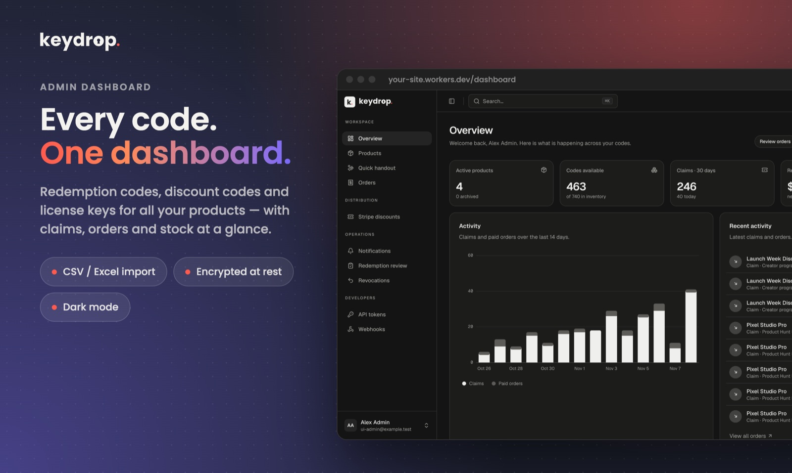
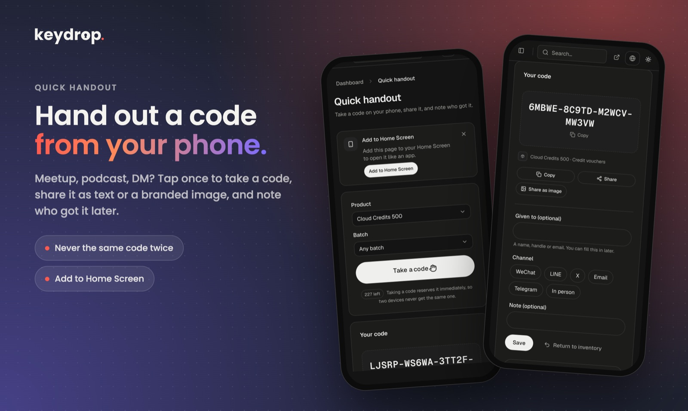
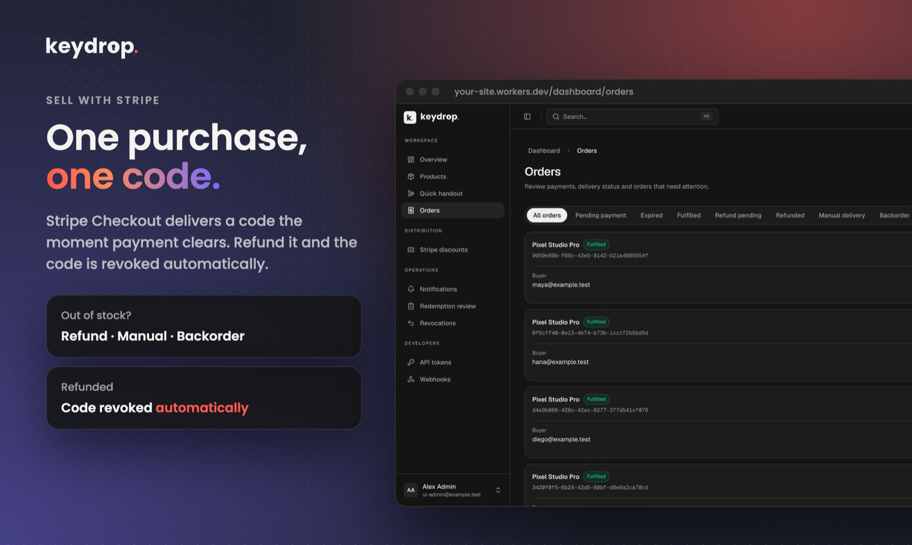
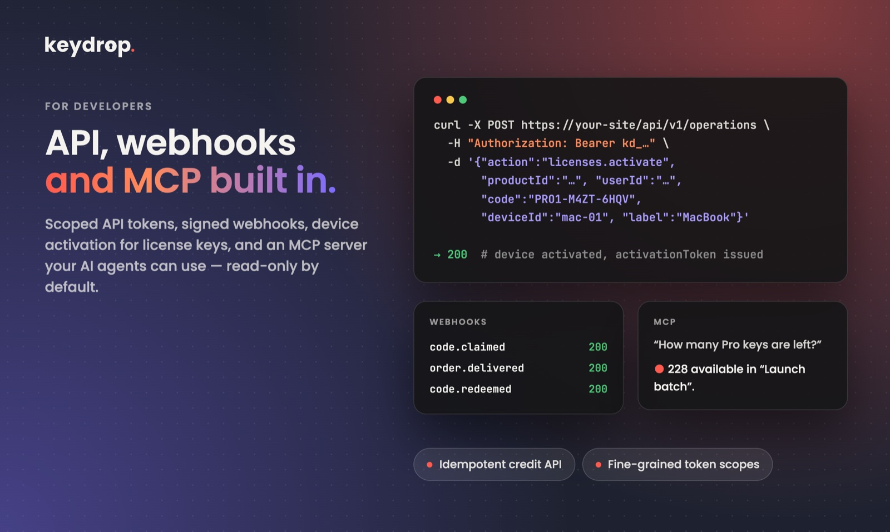
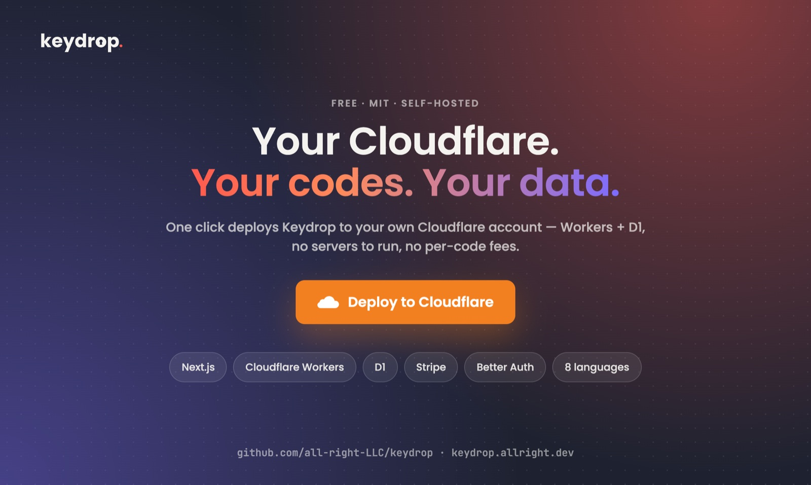

<p align="center">
  <picture>
    <source media="(prefers-color-scheme: dark)" srcset="apps/web/public/brand/keydrop-wordmark-dark.svg">
    
  </picture>
</p>

<p align="center"><a href="README.md">English</a> · <a href="README.zh-Hant.md">繁體中文</a> · <a href="README.zh-Hans.md">简体中文</a> · <a href="README.ja.md">日本語</a> · <b>한국어</b> · <a href="README.it.md">Italiano</a> · <a href="README.de.md">Deutsch</a> · <a href="README.ar.md">العربية</a></p>


**인디 개발자를 위한 셀프 호스팅 코드 배포 도구입니다.** 교환 코드, 할인 코드, 라이선스 키, App Store 프로모션 코드를 자신의 Cloudflare 계정에서 관리하고 배포합니다. 무료 수령 캠페인, Stripe 결제, 권한(entitlement), API, 웹훅, MCP 서버를 하나의 작은 Next.js 앱에 담았습니다.

[](https://deploy.workers.cloudflare.com/?url=https%3A%2F%2Fgithub.com%2Fall-right-LLC%2Fkeydrop%2Ftree%2Fmain%2Fapps%2Fweb)

[](https://github.com/all-right-LLC/keydrop/actions/workflows/ci.yml)
[](LICENSE)

<a href="https://www.producthunt.com/products/keydrop-2?embed=true&utm_source=badge-featured&utm_medium=badge&utm_campaign=badge-keydrop-2" target="_blank" rel="noopener noreferrer"><picture><source media="(prefers-color-scheme: dark)" srcset="https://api.producthunt.com/widgets/embed-image/v1/featured.svg?post_id=1308544&theme=dark"></picture></a>

> **상태:** 1.0 이전 버전입니다. 핵심 흐름은 Cloudflare에서 처음부터 끝까지 동작하지만, 1.0 전까지는 호환되지 않는 변경이 있을 수 있습니다. 실제 판매에 사용하기 전에 자신의 환경에서 먼저 테스트하세요.

<p align="center"></p>

<table>
  <tr>
    <td width="50%"></td>
    <td width="50%"></td>
  </tr>
  <tr>
    <td width="50%"></td>
    <td width="50%"></td>
  </tr>
</table>

## 왜 Keydrop인가

앱을 만들고 나면 프로모션 코드가 담긴 스프레드시트, 수백 개의 라이선스 키, 그리고 Stripe 계정이 남습니다. Keydrop은 이 코드들이 머물 곳을 제공합니다.

- **모든 종류의 코드를 하나의 인벤토리로** — 코드를 생성하거나 CSV/Excel에서 가져오고(App Store 오퍼 코드, 파트너 키, Stripe 프로모션 코드), 저장 시 암호화합니다.
- **원하는 방식으로 배포** — 자격 조건을 갖춘 공개 또는 비공개 수령 페이지, Stripe 유료 결제, 직접 할당, 이메일 배포, 채팅에서 코드를 건네기 좋은 모바일 친화적인 *Quick handout* 페이지를 지원합니다.
- **누가 무엇을 가졌는지 파악** — 모든 수령, 주문, 배포, 사용 내역이 기록됩니다. 기록을 잃지 않고 코드를 취소하고, 권한을 회수하고, 환불을 처리할 수 있습니다.
- **제품과 연동** — 범위가 지정된 API 토큰, REST API, 서명된 웹훅, MCP 서버를 통해 백엔드나 AI 에이전트가 코드를 발급하고 확인할 수 있습니다.
- **직접 운영** — MIT 라이선스, 단일 관리자 구조이며 자신의 Cloudflare Workers + D1에 배포합니다. 호스팅 서비스도, 코드당 수수료도 없습니다.

## 기능

**코드와 인벤토리**
- 네 가지 코드 종류: 교환 코드, 할인 코드, 라이선스(기기 수 제한이 있는 온라인 활성화), 외부 플랫폼 코드
- 생성, 가져오기(열 매핑과 미리보기를 지원하는 .xlsx / CSV), Stripe 프로모션 코드 동기화
- 저장 시 AES-GCM 암호화, 정확히 일치하는 검색, 내보내기, 취소 / 복원, 만료 및 코드별 사용 횟수 제한
- 고유 코드 또는 공용 코드 지원, 캠페인과 판매 전반에 걸친 공용 수령 한도

**배포**
- 수령 캠페인: 공개 또는 비공개 링크, 익명 / 이메일 인증 / 계정 전용, 1인당 및 전체 한도, 중첩 AND/OR 자격 규칙(기간, 암호 문구, 초대, 구매 내역, 직접 만든 HTTP 검사)
- Stripe Checkout: 구매당 코드 한 개, 할인, 코드를 취소할 수 있는 환불, 세 가지 재고 부족 전략(환불, 수동 처리, 재입고 후 자동 처리)
- 아직 계정이 없는 사람에게 직접 할당 및 이메일 배포
- **Quick handout** — 코드를 꺼내 공유하고(기기에서 그려지는 공유용 이미지 카드 세 종류 포함) 받은 사람을 기록하는 모바일 우선 페이지로, 홈 화면에 설치할 수 있습니다

**보상과 권한**
- 내장 멤버십(기간 한정 또는 영구)과 멱등적인 차감 / 환급 API를 갖춘 크레딧 원장
- 반복 보상은 누적, 대체, 거부 중에서 선택하며, 코드가 취소되면 사용하지 않은 권한을 회수
- 외부 보상은 자신의 서비스로 전달되며, 결과가 불분명하면 수동 검토

**연동**
- 제품 단위로 세밀하게 권한을 나눈 토큰을 사용하는 REST API와 MCP 서버(MCP는 기본적으로 읽기 전용)
- 재시도를 지원하는 서명된 발신 웹훅
- 일회용 코드 로그인, 코드 이메일, 관리자 알림을 위한 선택적 Cloudflare Email Sending

**관리자 콘솔**
- 활동 차트, ⌘K 명령 팔레트, 라이트 / 다크 테마, 모바일 레이아웃을 갖춘 SaaS 스타일 대시보드로, [beUI](https://beui.dev) 컴포넌트로 만들었습니다
- 인터페이스는 English, 简体中文, 繁體中文, 日本語, 한국어, Italiano, Deutsch, العربية(오른쪽에서 왼쪽 쓰기 지원)를 제공하며, 방문자의 브라우저 언어를 따르고 언제든 전환할 수 있습니다

## 기술 스택

[Next.js](https://nextjs.org) (App Router) on [Cloudflare Workers](https://workers.cloudflare.com) via [OpenNext](https://opennext.js.org/cloudflare) · [Cloudflare D1](https://developers.cloudflare.com/d1/) · [Better Auth](https://better-auth.com) · [Stripe](https://stripe.com)(선택) · [next-intl](https://next-intl.dev) · [beUI](https://beui.dev) + Tailwind CSS

## 빠른 시작

### Cloudflare에 배포

1. 위의 **Deploy to Cloudflare** 버튼을 클릭합니다. Cloudflare가 `apps/web` 폴더를 GitHub 계정의 새 저장소로 복사하고 Worker와 D1 데이터베이스를 만듭니다.
2. 요청하는 설정 값을 입력합니다.

   | 이름 | 입력할 내용 |
   |---|---|
   | `APP_URL` | 사이트의 HTTPS 오리진, 예: `https://keydrop.your-subdomain.workers.dev`(끝에 슬래시 없음) |
   | `ADMIN_EMAIL` | 단일 관리자의 이메일 주소 |
   | `BETTER_AUTH_SECRET` | 무작위 시크릿, 예: `openssl rand -hex 32` |
   | `SETUP_SECRET` | 설정 페이지에서 한 번 사용하는 또 다른 무작위 시크릿 |
   | `CODE_ENCRYPTION_KEY` | 16진수 64자, 예: `openssl rand -hex 32` — **반드시 백업하세요. 잃어버리면 기존 코드를 읽을 수 없습니다** |

   시크릿마다 다른 값을 사용하세요. 빌드 명령은 비워 두고 배포 명령은 `pnpm run deploy`로 설정합니다.
3. `APP_URL/setup`을 열고 `SETUP_SECRET`을 입력한 뒤 관리자 비밀번호를 정합니다. 그런 다음 로그인해 첫 번째 제품을 만듭니다.

무료 핵심 기능(코드, 캠페인, 수령)에는 다른 것이 필요하지 않습니다. Stripe와 Email Sending은 필요할 때 나중에 추가하면 됩니다.

### 로컬에서 실행

Node.js 24 이상과 pnpm이 필요합니다.

```sh
cd apps/web
pnpm install --frozen-lockfile
node scripts/create-local-env.mjs "$HOME/.config/keydrop/local.env" you@example.com
pnpm run db:migrate
KEYDROP_DEV_ENV_FILE="$HOME/.config/keydrop/local.env" pnpm dev
```

<http://localhost:3000/setup>을 열고 생성된 파일에 있는 `SETUP_SECRET`을 사용합니다(이 파일은 저장소 밖에 보관되며 터미널에 출력되지 않습니다).

### 수동 배포

```sh
cd apps/web
pnpm exec wrangler login
pnpm exec wrangler d1 create keydrop   # 데이터베이스 ID를 wrangler.jsonc에 넣습니다
# wrangler.jsonc에 Worker 이름, APP_URL, ADMIN_EMAIL을 설정한 다음:
pnpm exec wrangler secret put BETTER_AUTH_SECRET
pnpm exec wrangler secret put SETUP_SECRET
pnpm exec wrangler secret put CODE_ENCRYPTION_KEY
pnpm run deploy                        # 빌드, D1 마이그레이션 적용, 배포
```

## 설정

| 설정 | 유형 | 필수 여부 | 용도 |
|---|---|---|---|
| `APP_URL`, `ADMIN_EMAIL` | var | 필수 | 공개 오리진과 관리자 이메일 |
| `BETTER_AUTH_SECRET`, `SETUP_SECRET`, `CODE_ENCRYPTION_KEY` | secret | 필수 | 세션과 신원 해싱, 일회성 설정, 코드 암호화 |
| `STRIPE_SECRET_KEY`, `STRIPE_WEBHOOK_SECRET` | secret | 판매 시 | Stripe Checkout과 `/api/stripe/webhook`의 웹훅 |
| `EMAIL` binding + `EMAIL_FROM` | binding / var | 이메일 사용 시 | Cloudflare Email Sending: OTP 로그인, 코드 이메일, 관리자 알림 |
| `WEBHOOK_SECRETS` | secret | 웹훅 사용 시 | 발신 웹훅의 서명 시크릿 |
| `ELIGIBILITY_SECRETS`, `EXTERNAL_REWARD_SECRETS` | secret | 선택 | 직접 만든 자격 검사와 외부 보상 수신기의 서명 시크릿 |
| `KEYDROP_TELEMETRY` | var | 기본 켜짐 | 초기 설정이 끝날 때 한 번만 보내는 익명 신호(임의 ID＋버전), 설치 수 집계에만 사용합니다. `off`로 끌 수 있습니다. [자세히](docs/api/en/deployment.md#usage-statistics) |

크론 트리거가 5분마다 실행되어 예약을 만료시키고, 이월 주문을 처리하고, 대기 중인 이메일을 보내고, 웹훅을 전달합니다. `wrangler.jsonc`를 수정한 뒤에는 `pnpm run cf-typegen`을 실행하세요.

기능 스위치(공개 페이지, "My codes", 관리자 알림 이메일)는 `apps/web/src/config/site.ts`에 있고, 브랜딩과 모든 문구는 `apps/web/messages/<locale>.json`에 있습니다.

## 나만의 Keydrop으로 만들기

일반적인 배포에서 바꾸는 내용은 모두 몇 개의 파일에 모여 있습니다. 수정을 이 파일들 안에서만 하면 나중에 업스트림 업데이트를 받아오기가 쉬워집니다.

| 바꾸고 싶은 것 | 위치 (`apps/web/` 기준) |
|---|---|
| 브랜드 이름, 홈페이지와 페이지 문구, 이메일 문구 | `messages/<locale>.json`: `common.brand`, `home`, `publicSite`, `email` (제공하는 모든 언어에서 같은 키를 수정하세요) |
| 홈페이지 섹션과 순서, 선택형 공개 페이지, "My codes"와 관리자 알림 스위치 | `src/config/site.ts` |
| 푸터의 “Powered by Keydrop” 링크와 GitHub 링크(MIT상 선택 사항이며 끌 수 있습니다) | `src/config/site.ts`: `poweredBy.enabled`, `publicSite.repositoryUrl` |
| 홈페이지 레이아웃과 비주얼 | `src/components/site/landing/sections.tsx`, `src/components/site/landing/hero-visual.tsx`, `src/app/page.tsx` |
| 기능 페이지와 선택형 페이지(문서, 가격, 데모, 변경 기록) | `src/app/features/page.tsx`, `src/app/[section]/page.tsx` |
| 로고, 파비콘, 앱 아이콘 | `src/components/site/brand-logo.tsx`, `public/brand/`, `public/favicon.svg`, `src/app/favicon.ico`, `public/icons/`, `public/handout.webmanifest` |
| 색상과 라이트／다크 테마 | `src/app/globals.css` (`:root` 토큰과 `--brand-accent`) |
| 소셜 공유 이미지 | 빌드할 때마다 `scripts/generate-share-image.mjs`가 워드마크와 `home` 문구로 생성합니다 |
| 인터페이스 언어 | `src/i18n/locales.ts`와 `messages/` 안의 언어별 파일 하나 |
| Worker 이름, 공개 URL, cron 일정, 바인딩 | `wrangler.jsonc` (수정 후 `pnpm run cf-typegen` 실행) |

제품, 가격, 캠페인, 자격 조건, 이메일 발송, API 토큰은 코드가 아니라 대시보드에서 관리합니다.

다음은 이유를 알 때만 수정하세요. `migrations/`(새 파일을 추가하고, 기존 파일은 절대 수정하지 마세요), `src/lib/server/`(인증, 암호화, 결제, 재고 규칙), `src/components/motion/`(beUI 컴포넌트이므로 직접 고치지 말고 업스트림에서 업데이트하세요).

## 문서

전체 가이드는 [`docs/api`](docs/api/README.md)에 **영어**, [繁體中文](docs/api/zh-Hant/README.md), [简体中文](docs/api/zh-Hans/README.md)로 제공됩니다. 한국어 가이드는 아직 없으며, 아래 링크는 영어 문서로 연결됩니다.

- [배포, 백업 및 복원](docs/api/en/deployment.md) · [로컬 개발](docs/api/en/development.md) · [사용자 정의와 관리자 콘솔](docs/api/en/customization.md)
- [인증과 API 토큰](docs/api/en/authentication.md) · [MCP](docs/api/en/mcp.md) · [웹훅](docs/api/en/webhooks.md)
- [캠페인 조건](docs/api/en/conditions.md) · [자격 훅](docs/api/en/eligibility.md) · [권한과 크레딧](docs/api/en/entitlements.md) · [라이선스](docs/api/en/licenses.md)
- [Stripe](docs/api/en/stripe.md) · [Stripe 할인](docs/api/en/stripe-discounts.md) · [이메일](docs/api/en/email.md) · [Quick handout](docs/api/en/handouts.md)

## 번역

인터페이스는 8개 언어로 제공됩니다. 공개 페이지에는 `/ja/features` 같은 언어별 URL이 있으며, 이에 맞는 `hreflang` 태그와 사이트맵 항목도 함께 제공됩니다. 이메일은 각 수신자의 언어로 발송됩니다. 각 로케일은 [`apps/web/messages`](apps/web/messages)에 있는 JSON 파일로, `en.json`과 정확히 같은 키를 가집니다. 모든 번역의 키와 ICU 자리 표시자가 같은지 테스트로 확인합니다. 언어를 추가하려면 [`src/i18n/locales.ts`](apps/web/src/i18n/locales.ts)에 언어 코드를 추가하고 해당 JSON 파일을 만드세요. 원어민의 수정 제안을 언제나 환영합니다.

## 개발

```sh
cd apps/web
pnpm run lint
pnpm run typecheck
pnpm test                # 실제 SQLite + 마이그레이션 기반의 단위 및 통합 테스트
pnpm run build:worker    # 프로덕션 Worker 빌드
```

CI는 Node.js 24와 26에서 같은 검사를 실행하고, 새로 구성한 로컬 D1에서 코드 수령을 처음부터 끝까지 확인합니다. 풀 리퀘스트를 열기 전에 [CONTRIBUTING.md](CONTRIBUTING.md)를 읽어 주시고, 취약점은 [SECURITY.md](SECURITY.md)에 따라 신고해 주세요.

## 라이선스

[MIT](LICENSE) © all right LLC. 함께 포함된 [beUI](https://beui.dev) 컴포넌트는 원래의 MIT 라이선스를 유지합니다([`apps/web/vendor/beui.LICENSE`](apps/web/vendor/beui.LICENSE)).

## 감사의 말

Keydrop은 다음 프로젝트들 위에 만들어졌습니다. 이 프로젝트들을 만들고 유지해 주시는 모든 분께 감사드립니다.

- [Next.js](https://nextjs.org)와 [React](https://react.dev): 앱 프레임워크
- [OpenNext for Cloudflare](https://opennext.js.org/cloudflare), [Cloudflare Workers, D1](https://developers.cloudflare.com/), [Wrangler](https://developers.cloudflare.com/workers/wrangler/): 호스팅, 데이터베이스, 배포
- [Better Auth](https://better-auth.com): 로그인, 세션, 이메일 일회용 코드
- [Stripe](https://github.com/stripe/stripe-node): 결제
- [next-intl](https://next-intl.dev)과 [FormatJS](https://formatjs.github.io): 번역과 메시지 검사
- [beUI](https://beui.dev), [Tailwind CSS](https://tailwindcss.com), [Motion](https://motion.dev), [Lucide](https://lucide.dev), [Floating UI](https://floating-ui.com), [TanStack Virtual](https://tanstack.com/virtual), [next-themes](https://github.com/pacocoursey/next-themes), [clsx](https://github.com/lukeed/clsx), [tailwind-merge](https://github.com/dcastil/tailwind-merge): 인터페이스
- [Zod](https://zod.dev): 입력 검증
- [Kysely](https://kysely.dev)와 [kysely-d1](https://github.com/aidenwallis/kysely-d1): Better Auth의 데이터베이스 접근
- [Model Context Protocol TypeScript SDK](https://github.com/modelcontextprotocol/typescript-sdk): MCP 서버
- [SheetJS](https://sheetjs.com): Excel 가져오기
- [Geist](https://vercel.com/font)와 [Poppins](https://fonts.google.com/specimen/Poppins): 인터페이스와 로고 서체
- [Vitest](https://vitest.dev), [TypeScript](https://www.typescriptlang.org), [ESLint](https://eslint.org): 테스트와 개발 도구
